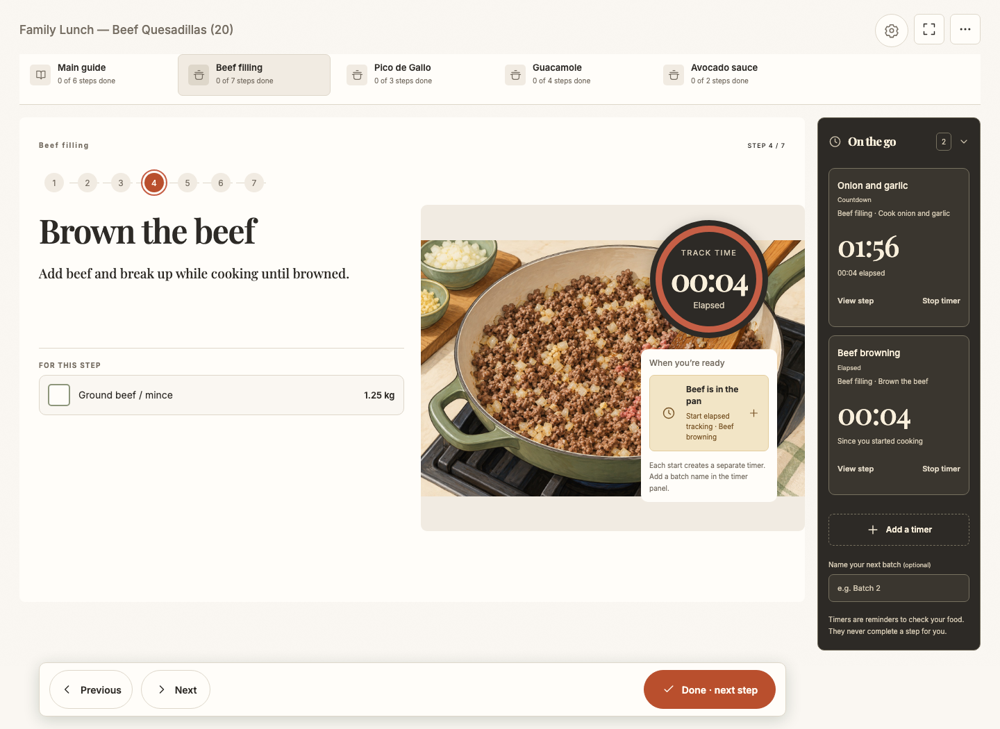
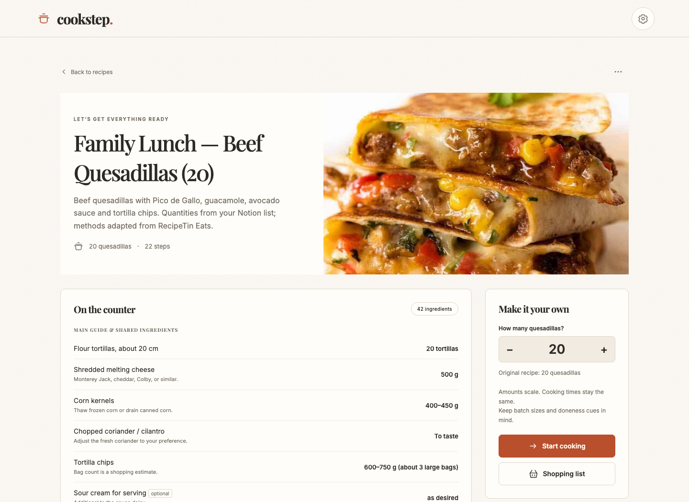
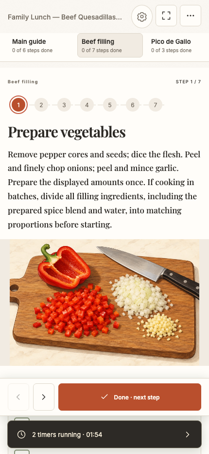
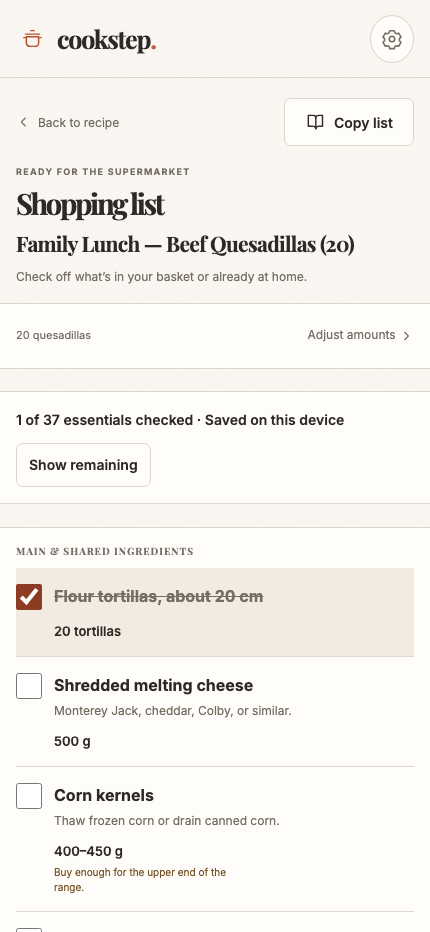
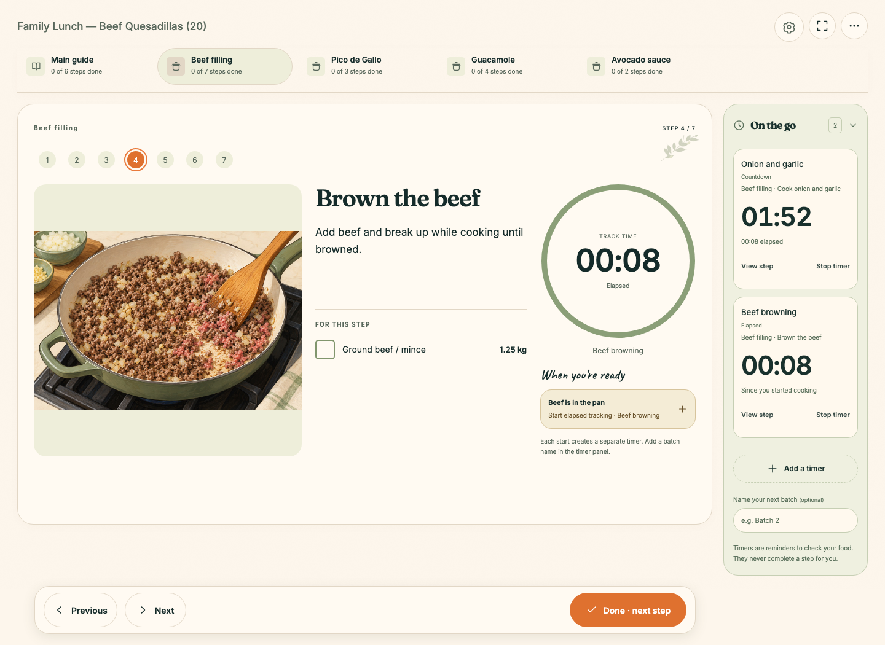
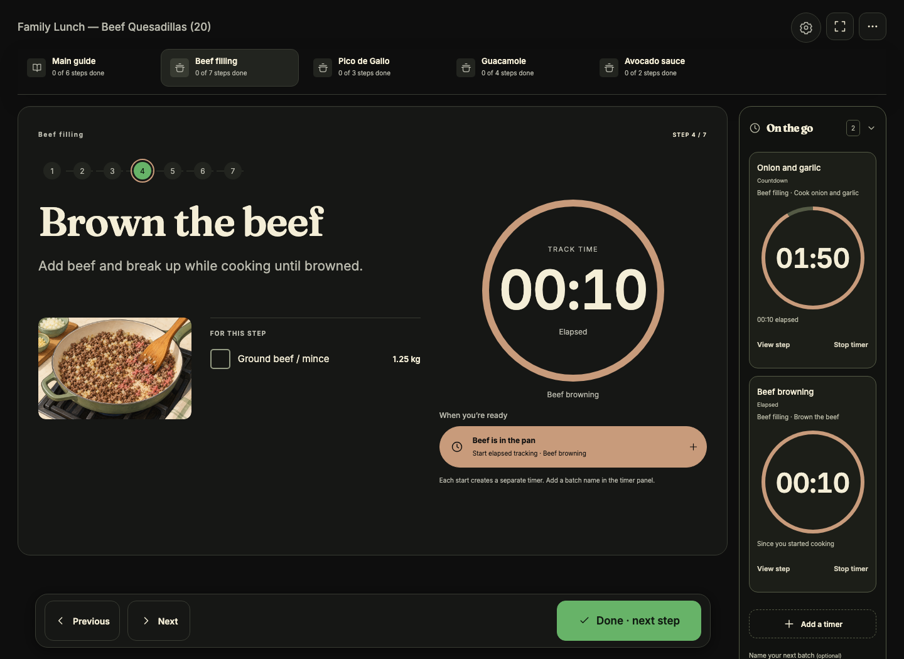
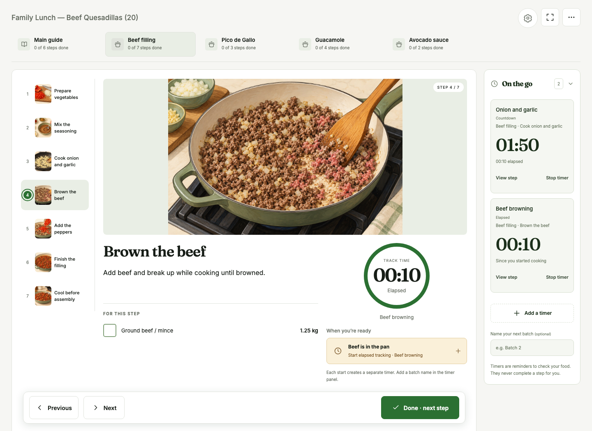

<p align="center">
  
</p>

<h1 align="center">Cookstep</h1>

<p align="center"><strong>A little calm in the kitchen.</strong></p>

<p align="center">Your recipes, a clear next step, and a timer for every pan.<br>Built for the moment your hands are busy and three things are cooking at once.</p>

<p align="center">
  <a href="#try-it-locally">Try it locally</a> ·
  <a href="https://cookstep-recipe-guide.alightslug4.chatgpt.site/">Recipe preparation guide</a> ·
  <a href="docs/DEVELOPMENT.md">Developer guide</a>
</p>



The filling is browning. The sauce needs a stir. You’ve lost your place in the recipe again.

Cookstep gives each part of a meal its own place. Switch between the main dish and sides, keep every timer in sight, and return to the exact step you left. Add or update recipes through ChatGPT, then put the screen on your kitchen counter and cook.

## From “what’s for dinner?” to dinner

1. **Bring a recipe you love.** Give ChatGPT a recipe link, text, or photo and ask it to prepare and save it through the Cookstep connection. JSON and ZIP import are also available.
2. **Make it fit your table.** Adjust the yield, check the ingredients and equipment, and create a shopping list with scaled amounts.
3. **Cook one step at a time.** Follow the main guide or work on a side dish. Check off prep, start a timer when the food actually hits the pan, and mark steps done yourself.
4. **Pick up where you left off.** Cooking progress and timer timestamps stay on your device across reloads. In the hosted app, your recipe library and images sync across devices.

## Made for cooking, not just collecting recipes

| At the counter | How Cookstep helps |
| --- | --- |
| A meal with several moving parts | Separate component tabs remember your position and progress. |
| Two pans and another batch to go | Named countdowns and elapsed timers stay visible while you switch tasks. |
| A recipe for two, dinner for six | Scaled ingredient amounts and shopping lists, with ingredient notes kept alongside. |
| A tablet covered in fingerprints | Large controls, readable steps, optional fullscreen, and screen wake lock where supported. |
| An unreliable kitchen connection | An installable PWA with saved recipes, images, lists, and cooking progress available offline after the initial download. |
| A recipe worth keeping | Share a PDF with anyone, or keep ZIP backups with the recipe and its images. Export your whole library too. |

**English, Spanish, and Czech.** Switch the interface language on any page, including while cooking. Prepared recipes support all three translations under the same recipe ID.

**Practical quantities.** Metric amounts and Celsius throughout, with spoon measures and approximate grams together for spices.

## A recipe book that comes to the counter



Keep the whole meal in view before you begin: a cover image, source links, the right amounts, and the equipment you’ll need.

<table>
  <tr>
    <th>At the stove</th>
    <th>At the supermarket</th>
  </tr>
  <tr>
    <td width="50%"></td>
    <td width="50%"></td>
  </tr>
</table>

## Four ways to feel at home

Choose a look that suits your kitchen. Change themes while cooking; your steps, checks, and timers stay put.

<table>
  <tr><th>Editorial Cookbook</th><th>Cozy Illustrated</th></tr>
  <tr>
    <td width="50%"></td>
    <td width="50%"></td>
  </tr>
  <tr><th>Kitchen Appliance</th><th>Recipe Studio</th></tr>
  <tr>
    <td></td>
    <td></td>
  </tr>
</table>

## Recipes, straight from ChatGPT

With the hosted Cookstep connection enabled, try:

> “Add this recipe to Cookstep for four people, with a shopping list and separate steps for the sauce.”

> “Update my quesadilla recipe to use less cheese and keep the existing photos.”

ChatGPT can find, read, add, and update recipes, including their images. Existing edits use revision checks to protect against overwriting a newer version. The [preparation guide](https://cookstep-recipe-guide.alightslug4.chatgpt.site/) explains how to structure a cooking-ready recipe; [the format reference](RECIPE_FORMAT.md) documents the portable JSON/ZIP contract.

To share a recipe, open **Recipe options → Export recipe PDF**. The download uses the current language and selected yield, including ingredients, equipment, every cooking task, timer instructions, photos, notes and source links. Recipients can read it without a Cookstep account. Export also works offline after the app has cached its PDF tools. ZIP export remains available for Cookstep backups and imports.

## Try it locally

Requires **Node.js 22.13+**. Start a browser demo:

```sh
git clone https://github.com/majermi4/cookstep.git
cd cookstep
npm ci
npm run build:assets
node scripts/serve.mjs
```

Open **http://127.0.0.1:4173** and choose **Try the example**. You can explore the cooking guide, timers, themes, shopping lists, and recipe import/export locally.

The static demo stores your work in this browser. Cross-device recipe sync and direct ChatGPT edits require the full hosted app, which uses ChatGPT Sites identity plus Cloudflare D1/R2 storage. The existing hosted collection is private; this public repository is the source code. See the [developer guide](docs/DEVELOPMENT.md#run-locally) to run the full server locally.

Timers require the app to be open for alerts; background and lock-screen notifications are not supported. Shopping lists, cooking sessions, and timers stay on each device. Physical iPhone/iPad installation, sound, and screen wake behavior still need device-specific verification.

## Build on Cookstep

The cooking interface is vanilla JavaScript and CSS, backed by IndexedDB. The hosted server uses TypeScript, React/Vinext, Cloudflare D1 and R2, and an MCP endpoint for recipe tools. Four themes share the same cooking state and behavior.

- [Development, verification, and deployment](docs/DEVELOPMENT.md)
- [Recipe preparation guide](AI_RECIPE_GUIDE.md) and [recipe format](RECIPE_FORMAT.md)
- [Design system and theme architecture](DESIGN.md)
- [Product specification](PRODUCT_SPEC.md)

Found a rough edge or have an idea that would make cooking easier? [Open an issue](https://github.com/majermi4/cookstep/issues).

<sub>Screenshots show the real app with an adapted sample recipe. Quesadilla photography and source recipe: <a href="https://www.recipetineats.com/quesadilla/">Nagi Maehashi / RecipeTin Eats</a>. The cooking-step illustration is AI-generated.</sub>
